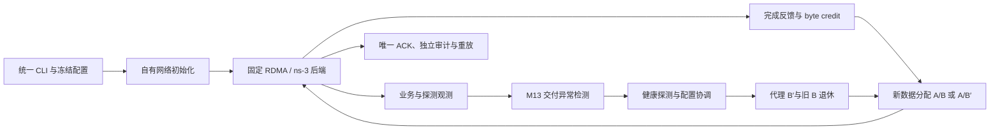

# 架构与完成语义

## 代码职责

* `network/`：读取本项目的拓扑与传输配置，创建节点、队列与路由。独立于 AstraSim 的训练入口。
* `runtime/`：逻辑 chunk、阶段、路由和实验状态，最终完成事件。
* `scheduling/`：固定偏移归属或完成反馈分流；全局阶段屏障。
* `detection/`：业务/探测分离的序列观测、M13 告警和探测预算。
* `recovery/`：代理选择、真实资源额度、完整路线探测、四方协调和 B→B′替换。
* `transport/`：物理 QP、线上 24 字节观测头、ACK 前缀与三段 store-and-forward。
* `control/`：100 Mb/s FIFO 与 1 ms 传播模型，按真实因果时间发送控制消息。
* `telemetry/`：独立事件与控制成本记录。
* `experiment/`：故障注入，仅供仿真环境和评分，检测器不读取其真值。

运行内核仍按确定的全局仿真时间顺序执行，模块共同使用一次实验的状态。当前通过单个编译单元连接这些模块，避免重构改变静态初始化顺序或事件注册顺序。划分职责后，后续可以逐步改为独立类和编译单元，须再次做轨迹一致性核验。

## 代理资格与完整路线

代理必须完成本阶段自己的全部发送和接收，拥有真实 NIC 与缓冲额度；完整路线经过近期健康探测，并完成 PREPARE/READY/COMMIT。路线为原源→同机代理→远端代理→最终目标。前两段完成不等于原任务完成；第三段确认后，还要把计费的最终确认送回原源。

旧尝试保留已确认前缀、增加 epoch，只转运未确认部分。旧 B 不接受新数据；B′作为持续候选承接新任务。固定组保持偏移奇偶归属，自适应组使用真实新 chunk 完成样本，救援后缀不混入新路线带宽样本。

## 明确的模型边界

只模拟通信，不做数值 AllReduce、CUDA 或真实 GPU 搬运。默认机内 2400 Gb/s 是配置值。候选选择使用模型中的阶段完成状态，另计健康探测和就绪确认；没有独立实现一个遍历服务器的代理发现协议。代理空闲规则和每 chunk 的最终控制通知会限制恢复后的有效吞吐。
