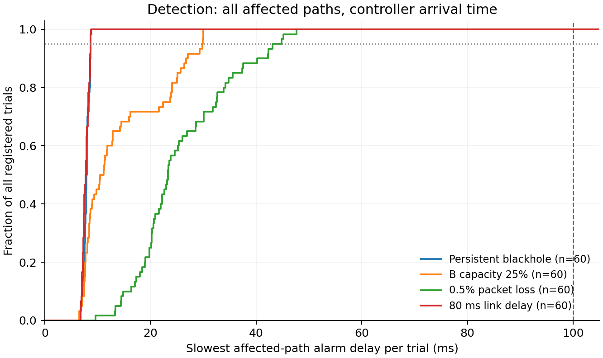
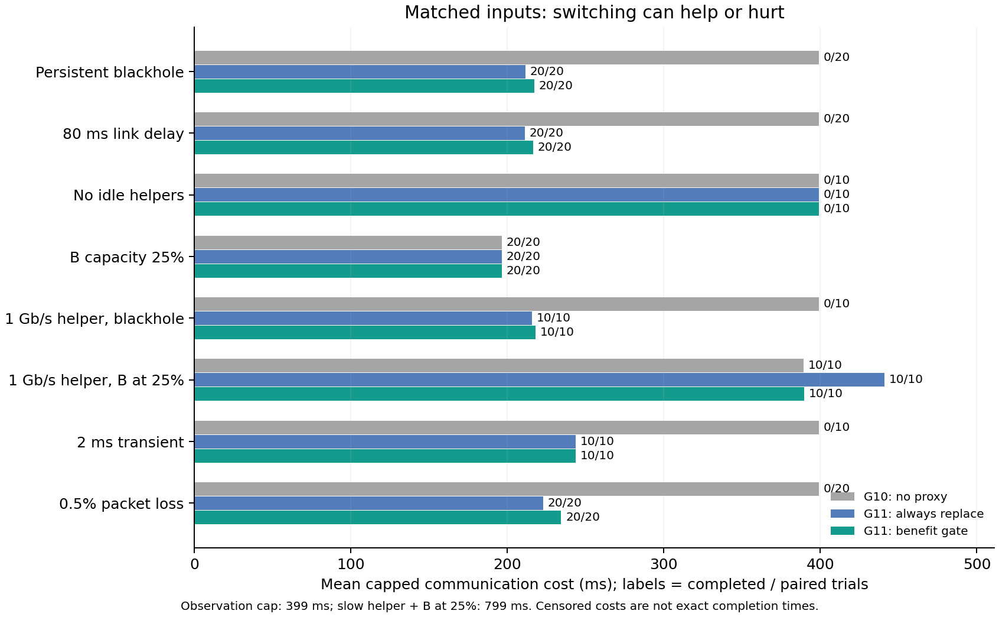

# LIMER：2026-10-28 冻结仿真实验结果

主矩阵注册 580 次、执行 580 次；加上独立丢包补充后共 640 次，通过执行审计与独立重放 640 次。检测验收结论：选定的四类队列均达到至少 95% 的试验严格 <100 ms。

## 检测：一次试验要把受影响路径都找对

每行 60 个 held-out 故障 trial；表中延迟取同次试验所有受影响方向的最慢报警，从注入到控制器实际收到报警。提前报、报错路径、漏报及错误都不能计入及时成功。

| 条件 | 来源 | <100 ms / 注册数 | 分类计数 | p95 ms | 最大值 ms | 单侧 95% 成功率下界 |
| --- | --- | ---: | --- | ---: | ---: | ---: |
| 持续黑洞 | validation-v2 | 60/60 | timely=60 | 8.64 | 8.81 | 95.13% |
| B 容量降至 25% | validation-v2 | 60/60 | timely=60 | 29.82 | 30.02 | 95.13% |
| 0.5% 弱丢包 | validation-loss-independent-v4 | 60/60 | timely=60 | 43.12 | 47.63 | 95.13% |
| 链路延迟增至 80 ms | validation-v2 | 60/60 | timely=60 | 8.66 | 8.72 | 95.13% |

主矩阵的弱丢包原队列包含 38 个不同的派生随机流对（注册 60 次），及时成功 60/60。原注入器使用 seed+node，故相邻 seed 可能复用丢包序列，不能把名义二项式下界当作独立抽样证据。
弱丢包检测行改由提前注册的 validation-loss-independent-v4 提供：60 个不复用序列的新 trial，原生代码、检测参数和核心审计器均保持相同。不把两队列池化提高通过率。其余三行及后面的策略配对仍来自主矩阵；策略表仅解释注册配对的经验差值。

下界按条件单独计算，未做多条件同时保证的校正。不能据此宣称任意灰故障都可检测。

以下边界也保留检测成绩，单独展示，不用于扩大四类主条件的通过率：

| 边界 | <100 ms / 注册数 | 分类计数 | 全分母 p95 ms |
| --- | ---: | --- | ---: |
| 无空闲代理 | 10/10 | timely=10 | 8.58 |
| 黑洞 + 1 Gb/s 慢代理 | 10/10 | timely=10 | 8.74 |
| B 降速 + 1 Gb/s 慢代理 | 10/10 | timely=10 | 12.45 |
| 2 ms 短暂故障 | 10/10 | timely=10 | 42.88 |

健康对照误报 0/60；它们是同一确定性健康轨迹的重复，不能当成 60 类业务覆盖。Canary 数据侧实际线上负载占 32 个发送端 NIC/平面出口总容量的平均值约 2.83%；每出口 10 Gb/s，不能泛化成任意 fabric 链路占用。此值含数据头，不含 transport ACK，控制消息另计。监测持续到观察上限，业务提前结束也不停止。

## 换路：同一输入下比较三种策略

无代理是 G10 自适应分流；直接换路是 G11 在告警、代理资格和计费探测通过后就协调换路；收益门控是 G11 再比较预计留下和换路的完成代价。两种 G11 使用相同 64 KiB 三段探测和 96 B 健康报告。这些是内部机制消融，不是与 OptCC、VCCL 等外部系统的完整头对头复现。

下表只用完整注册配对，主条件各 20 对，边界各 10 对。时间从业务启动的 1 ms 算起；未完成或错误按观察上限计入截尾成本，因此不是精确完成时间，也不能直接换算加速比。

| 条件 | 有效 / 注册配对 | 截尾上限 ms | 完成数：无代理 / 直接换 / 收益门控 | 平均截尾成本 ms：无代理 / 直接换 / 收益门控 | 门控 − 直接换 ms |
| --- | ---: | ---: | --- | --- | ---: |
| 持续黑洞 | 20/20 | 399 | 0 / 20 / 20 | 399.00 / 211.41 / 217.16 | +5.75 |
| 链路延迟增至 80 ms | 20/20 | 399 | 0 / 20 / 20 | 399.00 / 211.09 / 216.47 | +5.38 |
| 无空闲代理 | 10/10 | 399 | 0 / 0 / 0 | 399.00 / 399.00 / 399.00 | +0.00 |
| B 容量降至 25% | 20/20 | 399 | 20 / 20 / 20 | 196.41 / 196.41 / 196.41 | +0.00 |
| 黑洞 + 1 Gb/s 慢代理 | 10/10 | 399 | 0 / 10 / 10 | 399.00 / 215.53 / 217.84 | +2.31 |
| B 降速 + 1 Gb/s 慢代理 | 10/10 | 799 | 10 / 10 / 10 | 389.15 / 440.80 / 389.54 | -51.26 |
| 2 ms 短暂故障 | 10/10 | 399 | 0 / 10 / 10 | 399.00 / 243.63 / 243.63 | +0.00 |
| 0.5% 弱丢包 | 20/20 | 399 | 0 / 20 / 20 | 399.00 / 222.76 / 234.36 | +11.60 |

在全部配对有效时，负差值表示门控的截尾成本更低，正值表示更高。若存在无效配对，惩罚值仍留在表中，但不能把差值当成可靠的性能效果。门控使用近 10 ms ACK 服务、剩余工作、三段候选路线实测、控制排队、协调和最终确认，预计收益须超过 max(1 ms, 10% 留下代价)。它不知道未来故障何时结束，也不保证每种场景都赢。无空闲代理时，及时检测不等于能够恢复。

## 如何达到快速检测

同物理路径每 2 ms 发 64 KiB canary；先用健康的前 20 ms 冻结服务参考。40 ms 窗口内有三个异常 canary，且发送跨度至少 4 ms，就可报警。异常来自真实超时或重传；真实业务 ACK 40 ms 无进展提供另一条信号。v4 还汇总同路径所有业务和探测包的接收间隔：前 20 ms 校准 P10，之后连续两个 10 ms 窗口（每窗至少 64 个间隔）的 P10 超过 2×基线+100 ns 就报警。这使持续异常通常不用等 100 ms 才积累证据，报警仍支付实际控制消息运输时间。

## 正确性、证据和边界

执行审计检查物理双平面、NIC/代理 credits、ACK 前缀、epoch、三段到达及最终确认；独立重放从实际 QP、重传、ACK、接收包间隔和控制 FIFO 重建检测和决策。全量归档完整性结果见 [主矩阵核验](integrity-validation-v2.json)。独立丢包补充另见 [补充队列核验](integrity-validation-loss-independent-v4.json)。

该模拟器不执行张量数值、CUDA、HBM 或计算重叠；当前结论限定在 16-GPU 拓扑、正常启动校准和注册的故障/业务分布。收益估计是 sender/phase 层近似，未实现全局 DAG 最优选择。代理发现仍依赖阶段状态；启动即退化、代理二次故障、恢复旧 B 和任意拥塞背景尚未验收。

一次迁移完成不等于后续 B′持续承担新业务；需同时查看 performance.json 的 new_Bprime_completions/sustained_new_proxy_observed，不能把在途抢救描述成恢复健康双平面吞吐。

冻结计划 SHA-256：`67b754bd64d590b1d66d8357f5157a9bf3b75779f25d51b872e7ac2fd6e6b5e6`。

原生二进制 SHA-256：`9c1b0fbbd1ffe87b6f4b0502e961a1f264a05f511e06497fbed7c94aae19f8b9`。

开发失败与正式验证分开保存。全量原始数据留在 otakotak；本地导出仅做紧凑证据核验。

主矩阵四类主条件的收益门控共 240 次：180 次实际激活代理，1107 个在途 chunk 发起抢救，0 个新分配 B′ chunk 完成，0 次满足至少两个 phase 有新 B′完成。各条件/方法的细分与决策原因计数在 report.json；原因计数是评估次数，不等于实际切换次数。

## 图

