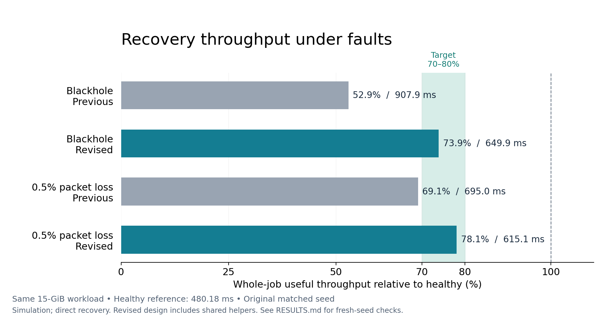

# Recovery throughput results — 2026-11-12

This report is generated from the retained compact evidence. Results are
simulated whole-job useful throughput, not physical GPU throughput.

## Target and fixed workload

For equal payload, healthy-normalized throughput is `T_healthy / T_fault`.
The healthy reference is 480.178448 ms. Retaining 70–80% therefore means
approximately 600.22–685.97 ms for the same job; faster is also acceptable.
The detection deadline of 100 ms is separate from job completion.

All full cases use 16 logical GPUs, four per server, two 10-Gb/s access
planes, 2400-Gb/s intra-server links, 64-KiB chunks, 512 chunks per rank
per phase and 30 phases: 245,760 chunks / 15 GiB total useful payload.
Fault onset is 40 ms; observation horizon is 2 s. Blackhole removes
delivery on node 0's B access link. Weak loss drops 0.5% of packets on
that link. Both directions are affected, hence logical sources 0 and 15.
These physical fault definitions and detector rules are unchanged.

## Matched original-seed comparison

| Condition | Prior direct recovery (ms) | Candidate direct recovery (ms) | Candidate / healthy throughput | Fresh B′ chunks |
|---|---:|---:|---:|---:|
| healthy | 480.18 | 480.18 | 100.00% | 0 |
| blackhole | 907.90 | 649.92 | 73.88% | 10318 |
| weak_loss | 694.96 | 615.10 | 78.07% | 7479 |

Candidate rows use pipelined resource release, shared helpers and disjoint
helper selection. Both old fault rows use `policy=always`; this comparison
does not replace the old method with its slower benefit-gated variant.
The matched healthy candidate is identical to the old denominator.

## All seven full-size attempts

| Seed | Condition | Helper mode | Status | Job ms | Healthy reference % | Detection ms | Fresh B′ chunks / phases |
|---|---|---|---|---:|---:|---:|---:|
| 111210016 | healthy | shared | completed | 480.18 | 100.00 | — | 0 / 0 |
| 111210016 | blackhole | shared | completed | 649.92 | 73.88 | 8.02 | 10318 / 28 |
| 111210016 | weak_loss | shared | completed | 615.10 | 78.07 | 20.03 | 7479 / 27 |
| 111210016 | blackhole | idle | completed | 868.17 | 55.31 | 8.02 | 3124 / 28 |
| 111212001 | healthy | shared | completed | 480.18 | 100.00 | — | 0 / 0 |
| 111212001 | blackhole | shared | completed | 649.92 | 73.88 | 8.02 | 10318 / 28 |
| 111212001 | weak_loss | shared | completed | 624.97 | 76.83 | 30.07 | 7500 / 27 |

Shared-helper rows use their matched healthy seed. The idle-only control
uses the unchanged 480.178448-ms original healthy reference; it has no
separately registered full-size idle-mode healthy run. The v1 pilot checks
all three modes against the identical 63.965513-ms short healthy run.
The fresh seed is one development recheck, not a statistical guarantee.

The seed controls fault-loss sampling. Healthy and complete-blackhole
conditions are deterministic here; matching them across seeds does not
provide independent stochastic replication. The weak-loss pair is the
meaningful new random-loss check.

## Why the execution became faster

1. The final data leg releases physical relay resources; final logical
   completion still waits for the same charged notification. A bounded
   32-chunk confirmation window allows data to continue during that wait.
2. A helper can lend one of its four NIC admission credits before its own
   work finishes. Its own new admissions use at most three. Existing
   links, bandwidth, buffer limits and contention remain simulated.
3. Concurrent recoveries select disjoint helper GPUs, avoiding two relay
   jobs competing for one helper's buffer pool.

**Shared helpers extend the collaborator's idle-only architecture.** The
improvement must not be described as a pure implementation correction of
that earlier assumption. The final timing includes all helpers' own work.
The control FIFO, 1-ms propagation, full representative probe, health
report, PREPARE/READY/COMMIT, health TTL and final ACK are unchanged.

In the original-seed blackhole run, post-fault phases 3–29 average
21.975 ms. The retained logical-event
diagnosis finds helper rank 1 critical in 20 phases and helper rank 12
critical in seven. Their own outgoing work, rather than an unaccounted
free backup link, sets the remaining job tail. The source confirmation
window covers at most 2 MiB of unconfirmed logical payload per rank
instead of 512 KiB; this is a payload bound, not measured memory use.

## Development history and failures

| Version | Condition | Completion mode / helper | Status | Job ms |
|---|---|---|---|---:|
| pilot-v1 | blackhole | final_ack / idle | completed | 87.785 |
| pilot-v1 | blackhole | pipelined / idle | completed | 86.933 |
| pilot-v1 | blackhole | pipelined / shared | completed | 82.098 |
| pilot-v1 | healthy | final_ack / idle | completed | 63.966 |
| pilot-v1 | healthy | pipelined / idle | completed | 63.966 |
| pilot-v1 | healthy | pipelined / shared | completed | 63.966 |
| pilot-v1 | weak_loss | final_ack / idle | completed | 90.726 |
| pilot-v1 | weak_loss | pipelined / idle | completed | 87.465 |
| pilot-v1 | weak_loss | pipelined / shared | completed | 85.773 |
| pilot-v1 | quarter | pipelined / shared | completed | 79.261 |
| pilot-v1 | delay | pipelined / shared | completed | 82.098 |
| pilot-v1 | no_idle_helpers | pipelined / shared | task_unfinished | — |
| pilot-v2 | blackhole | pipelined / shared | completed | 78.615 |
| pilot-v2 | weak_loss | pipelined / shared | completed | 86.901 |
| pilot-v2 | healthy | pipelined / shared | completed | 63.966 |

The historical `no_idle_helpers` condition blackholes all four B links
of one server. It leaves no healthy local B helper and remains unfinished
at 400 ms. A fast alarm does not imply successful recovery. No automatic
migration of outstanding B work back onto A is validated here.

v2 improved the blackhole pilot but slightly worsened the weak-loss pilot
(85.773350 → 86.900553 ms). The selection is therefore checked on the full
registered workload and a fresh seed; the adverse pilot is retained.

Earlier integration failures also remain untouched. In particular, the
old benefit gate took 975.894384 ms under weak loss, compared with
694.962340 ms for direct recovery. This revision does not certify that
estimator or claim an optimal switching decision.

## Supplementary gate diagnostic on the frozen candidate

These two additional four-phase cases change only `policy=always` to
`policy=benefit`. They were registered after the original-seed full
direct-recovery results and before executing the diagnostic. The aim is
to check compatibility of the existing estimator with the new resource
model, not to pool extra attempts into throughput acceptance.

| Condition | Direct recovery ms | Benefit gate ms | Gated fresh B′ chunks | Gate execution status |
|---|---:|---:|---:|---|
| blackhole | 78.615 | 78.615 | 419 | completed |
| weak_loss | 86.901 | 98.790 | 0 | completed |

The direct-recovery throughput result must not be attributed to the
benefit gate. These short diagnostics do not establish a full-size
gate benefit. The candidate estimator still models relay parallelism
using four credits with the final-notification delay and has no
separate per-chunk stalled-tail model.

Lending admission remains active while the rejected gate waits to retry,
until the phase reset. This cost is included in measured job completion
but not separately represented in the estimator. The policy contrast
demonstrates a regression; it does not isolate the contribution of each
estimation or admission-state issue.

A concrete counterexample remains in `diagnostics/gate-counterexample.json`:
at 88.417750 ms, source 0 predicted that 288 remaining B bytes would
finish in 572 ns and refused recovery. At 94.517750 ms, the same 288
bytes remained; the gate finally switched after the recent-service
estimate dropped to zero. Source 15 shows the same pattern with 432
bytes. Both native decisions and their inputs pass independent replay.

## Correctness and evidence limits

All 24 registered attempts are retained: 24 pass execution/observation auditing.
Communication outcomes: 23 completed, 1 unfinished.
An execution-valid unfinished job remains a performance failure.

Audit checks include exact logical payload accounting, final target
notification, phase barriers and reset, causal lending/probe/control
delivery, four-credit physical NIC limits and four helper buffers.
Detector alarms are independently replayed from packet-derived
observations. The 152-test regression suite also passes.

This small development cohort does not independently establish the
95%-within-100-ms detection target, general fault coverage, scale-out
performance, numerical AllReduce correctness, or physical GPU results.
The healthy helper assumption, fixed topology/control latency and
additional bounded confirmation state remain part of the model.

Evidence: `results/*/trials.csv`, `evidence/*/registration.json`,
`verification/final-check.json`, and `review/throughput-v2.patch`.
Reproduce table derivation with `python3 verify_compact.py`. Raw packet
archives remain under `otakotak:/home/suliu/data/LIMER_THROUGHPUT_2026-11-12`.
No commit, push, or Overleaf update is part of this revision.
